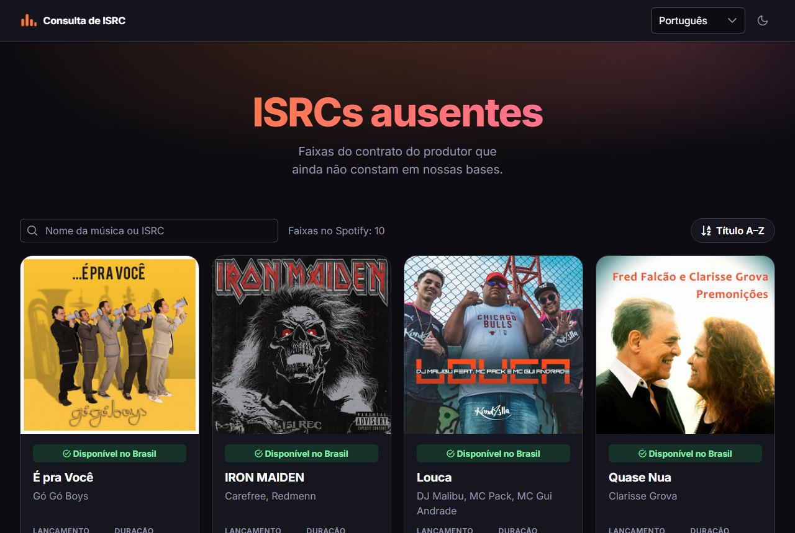
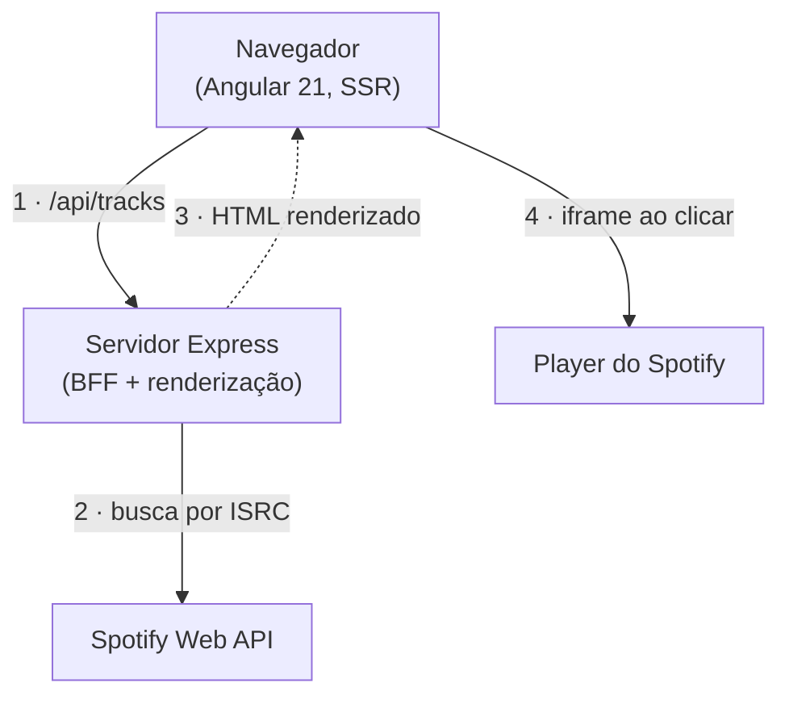

# Consulta de faixas por ISRC

[](https://github.com/AlyssonMascarenhas/onerpm-challenge/actions/workflows/ci.yml)

Página pública que recebe **10 códigos ISRC** que ainda não constam na base, consulta a **Spotify Web API** e mostra cada faixa
(capa, data de lançamento, título, artistas, duração `mm:ss`, prévia do áudio, link no Spotify e se está disponível no Brasil),
**ordenadas por título**, sem guardar nada. Se o Spotify estiver fora, o visitante vê um alerta.

**No ar:** <https://onerpm-challenge-ssr.vercel.app>

<p align="center">
  
  
</p>

> O enunciado original do desafio está no fim deste arquivo, [intacto](#enunciado-original).

## Sumário

- [O que o projeto resolve](#o-que-o-projeto-resolve)
- [Como funciona](#como-funciona)
- [Decisões de arquitetura](#decisões-de-arquitetura)
- [Rodando localmente](#rodando-localmente)
- [Garantindo que está tudo certo](#garantindo-que-está-tudo-certo)
- [Onde está no ar e como foi implantado](#onde-está-no-ar-e-como-foi-implantado)
- [Evolução possível](#evolução-possível)
- [Documentação e convenções](#documentação-e-convenções)
- [Enunciado original](#enunciado-original)

## O que o projeto resolve

Durante o fechamento de contrato com um produtor chegaram 10 ISRCs ausentes da base. A página responde "que faixas são
essas?" sem cadastro, sem banco e sem expor credenciais. Cada requisito do enunciado tem um lugar claro:

| Requisito | Como foi atendido | Detalhe |
| --- | --- | --- |
| Dados da faixa (thumb, data, título, artistas, `mm:ss`, link) | Um `TrackCard` por faixa; duração e data por funções puras | [ADR 0010](docs/adr/0010-dominio-de-faixas-no-front.md), [0013](docs/adr/0013-cartoes-de-faixa-e-player-do-spotify.md) |
| Prévia do áudio | Player oficial (embed) do Spotify, numa barra fixa e carregado só ao clicar | [ADR 0013](docs/adr/0013-cartoes-de-faixa-e-player-do-spotify.md), [0016](docs/adr/0016-barra-de-reproducao-fixa.md) |
| Disponível no Brasil (BR) | Busca com `market=BR` e `is_playable`; selo com ícone **e** texto | [ADR 0005](docs/adr/0005-regras-de-consulta-ao-spotify.md) |
| Ordem alfabética por título | `sortResults` (sem acento, maiúsculas ou pontuação); botão A–Z / Z–A | [ADR 0010](docs/adr/0010-dominio-de-faixas-no-front.md), [0019](docs/adr/0019-endurecimento-do-servidor-e-ordem.md) |
| Sem armazenamento | Nada é persistido; só um cache em memória no servidor (horas, com resposta antiga se o Spotify falhar) | [ADR 0003](docs/adr/0003-bff-no-angular-ssr.md) |
| Alerta se a integração cair | A API responde `503 integration_unavailable` e o front mostra o alerta com "tentar novamente" | [ADR 0005](docs/adr/0005-regras-de-consulta-ao-spotify.md) |
| Responsivo | Grade de 4 colunas no desktop e cartão compacto no celular | [ADR 0017](docs/adr/0017-grade-de-4-colunas-e-cartao-compacto.md) |
| Angular LTS | Angular 21 (LTS) | [ADR 0002](docs/adr/0002-angular-21-lts.md) |
| Testes unitários e de integração (diferencial) | Vitest com cobertura mínima, e2e com Playwright e auditoria de acessibilidade (axe) | [ADR 0007](docs/adr/0007-estrutura-do-bff-e-testes.md), [0014](docs/adr/0014-testes-e2e-e-acessibilidade.md) |
| Versionamento | Conventional Commits, commitlint, uma branch e um PR pequeno por etapa | [ADR 0004](docs/adr/0004-commits-semanticos-e-fluxo-de-prs.md) |

Além do pedido: seis idiomas (en, pt, es, ru, fr, tr) com tema claro e escuro, filtro por título ou ISRC, copiar ISRC,
lista dos ISRCs que o Spotify não tem, e acessibilidade WCAG AA verificada em teste.

## Como funciona



1. O navegador pede `GET /api/tracks?isrc=…` ao servidor.
2. O servidor usa _Client Credentials_ e busca cada ISRC na Spotify Web API.
3. O servidor devolve o HTML já renderizado, no idioma do visitante e **com as faixas** (ele mesmo faz a busca 1 e passa o resultado ao navegador, que não pede de novo).
4. O player do Spotify (iframe) só é carregado quando a pessoa clica em ouvir.

- **O segredo nunca vai ao navegador.** O Client Secret do Spotify vive só no servidor, que troca as credenciais por um token
  e faz as buscas. O front chama apenas `/api/tracks`.
- **Regras de consulta** (verificadas com dados reais, ADR 0005): busca por `isrc:` com `market=BR`; a faixa é "disponível no
  Brasil" se vier tocável nesse mercado, "indisponível" se só aparecer sem `market`, e "não encontrada" se não aparecer; com
  várias faixas para o mesmo ISRC vale a de menor data de lançamento; a prévia usa o embed oficial porque o Spotify não envia
  mais `preview_url`.
- **Um servidor, uma página.** O mesmo servidor Express renderiza o Angular (SSR) e serve o BFF, então há um único artefato
  para implantar.

```text
src/
  app/            Angular: core (i18n, tema), layout, shared, features/tracks (api, store, domain, spotify, components, pages)
  bff/            servidor: config, http (cabeçalhos), spotify (cliente, token, limites), tracks (busca e mapeamento), api (rotas)
  server.ts       Express: BFF em /api, compressão, cabeçalhos de segurança e a renderização
api/index.mjs     entrada da função da Vercel (reexporta o servidor)
e2e/              testes de ponta a ponta (Playwright + axe)
docs/adr/         registros das decisões
```

## Decisões de arquitetura

Cada decisão tem um registro (ADR) com contexto, alternativas e consequências; aqui vai o resumo do que se **ganha** e do que
se **paga**.

### Angular 21 (LTS) com SSR — [ADR 0002](docs/adr/0002-angular-21-lts.md)

- **Por quê:** o enunciado pede a versão LTS e o ambiente (Node 24.3) não roda a 22.
- **Ganha:** aderência literal ao requisito; _standalone_, _signals_ e _zoneless_ desde o início.
- **Paga:** uma migração para a 22 mais tarde; exige Node `^22.12 || >=24` e npm ≥ 11.6 (o 11.4 falha ao resolver as dependências); as ferramentas de dev (lint-staged, ESLint) pedem 22.22.1+ e só avisam em versões menores.

### BFF dentro do servidor do Angular — [ADR 0003](docs/adr/0003-bff-no-angular-ssr.md)

- **Por quê:** o Spotify exige Client Secret, que não pode ir ao navegador; um servidor separado dobraria o que há para implantar.
- **Ganha:** segredo isolado, um só artefato, cache e controle de taxa no servidor, HTML renderizado na primeira resposta **já com as faixas** (o servidor busca no próprio BFF e entrega o resultado ao navegador por `TransferState`; o store usa `rxResource`, [ADR 0025](docs/adr/0025-ssr-renderiza-as-faixas-e-store-com-rxresource.md)).
- **Paga:** o app deixa de ser estático (precisa de Node); a primeira resposta espera o BFF (até 6 s; se falhar, sai o esqueleto e o navegador refaz); o cache e o limitador valem por instância. O cache guarda por 6 h e, se o Spotify falhar (ex.: `429` de ~1 h), serve a resposta vencida por até 24 h ([ADR 0024](docs/adr/0024-cache-longo-com-resposta-antiga-e-saude-do-spotify.md)).

### Regras do Spotify e anti-corruption layer — [ADR 0005](docs/adr/0005-regras-de-consulta-ao-spotify.md), [0007](docs/adr/0007-estrutura-do-bff-e-testes.md)

- **Por quê:** a API mudou em 2026 (sem `available_markets`, `limit` ≤ 10, sem lote, sem `preview_url`); o formato do Spotify fica
  isolado num _mapper_ e o resto trabalha com o nosso domínio, atrás de `TrackSearch`.
- **Ganha:** regras testáveis e determinísticas; trocar a fonte de dados mexe em um lugar; limites de concorrência e `Retry-After` tratados.
- **Paga:** mais arquivos que um serviço único; o embed é um iframe de terceiro e a prévia depende do Spotify.

### Domínio puro no front e estado em signals — [ADR 0010](docs/adr/0010-dominio-de-faixas-no-front.md)

- **Por quê:** ordenar, filtrar e formatar são regras que merecem teste sem Angular.
- **Ganha:** funções puras rápidas de testar; `TracksStore` (signals) como única fonte do estado da tela.
- **Paga:** a ordem "A–Z" segue uma colação universal (`en`), não o alfabeto de um idioma específico.

### Organização por domínio e camadas — [ADR 0008](docs/adr/0008-convencoes-de-organizacao-de-codigo.md), [0023](docs/adr/0023-organizacao-de-pastas-por-responsabilidade.md), [0027](docs/adr/0027-convencoes-de-codigo-menos-rigidas.md)

- **Por quê:** convenção que só está escrita se perde; o ESLint recusa importações que sobem de camada, `any`, acesso implícito e nomes fora do padrão.
- **Ganha:** dá para saber o que cada pasta pode usar; declarações ficam junto de quem as usa e só vão para `*.constants|enums|interfaces|types.ts` quando compartilhadas.
- **Paga:** a regra "um arquivo por tipo de declaração" do ADR 0008 foi **abandonada** (gerava arquivos de uma linha); onde cada declaração mora agora depende da revisão. Conjuntos fechados que cruzam uma fronteira continuam sendo `enum`.

### Internacionalização com Transloco, também no servidor — [ADR 0011](docs/adr/0011-i18n-com-transloco.md), [0026](docs/adr/0026-idioma-salvo-em-cookie.md)

- **Por quê:** seis idiomas pedidos; o idioma vem da escolha salva (um **cookie**, que o servidor também lê), do navegador ou do `Accept-Language`, na mesma ordem nos dois lados.
- **Ganha:** HTML correto desde a primeira resposta; troca instantânea; teste que falha se faltar chave em algum idioma.
- **Paga:** cada requisição é renderizada no servidor; `Vary: Accept-Language, Cookie` reduz o reaproveitamento de cache; todo texto novo vai em seis arquivos.

### PrimeNG com tema próprio e modo escuro — [ADR 0006](docs/adr/0006-primeng-e-mcp.md), [0012](docs/adr/0012-tema-e-layout-com-primeng.md)

- **Por quê:** componentes acessíveis prontos, sem Tailwind; paleta própria inspirada em música (não é a marca oficial).
- **Ganha:** consistência, tokens num só lugar (`theme.constants.ts`) e contraste AA testado.
- **Paga:** dependência grande de UI; o tema escuro precisa de um script antes da pintura para não piscar. O preset leva só os
  _tokens_ dos componentes usados (o Aura inteiro pesava ~106 kB): bundle inicial de 772 → **706 kB** brutos (174 → 169 kB
  transferidos), com aviso de orçamento em 750 kB. O que ainda pesa é o `p-select` do idioma (~110 kB) e o roteador (~66 kB).

### Cartões, grade e player — [ADR 0013](docs/adr/0013-cartoes-de-faixa-e-player-do-spotify.md), [0015](docs/adr/0015-acabamento-da-interface.md), [0016](docs/adr/0016-barra-de-reproducao-fixa.md), [0017](docs/adr/0017-grade-de-4-colunas-e-cartao-compacto.md), [0018](docs/adr/0018-filtro-copia-e-isrcs-ausentes.md)

- **Por quê:** o produtor precisa comparar 10 faixas de relance e ouvir uma de cada vez.
- **Ganha:** linhas alinhadas (`subgrid`), um único player na barra fixa (carregado só ao clicar, com contingência para o embed
  simples), cartão compacto no celular, filtro e lista dos ISRCs ausentes; URLs do iframe só saem de funções que validam o id. Se o Spotify
  cair, a página mostra um painel centrado e responsivo (botão "Tentar novamente" que preenche a largura no celular), e não uma
  barra de largura total.
- **Paga:** dependência do iframe e da iFrame API do Spotify; o volume não existe na API do embed.

### Servidor endurecido — [ADR 0019](docs/adr/0019-endurecimento-do-servidor-e-ordem.md)

- **Por quê:** a página é pública.
- **Ganha:** sem `X-Powered-By`, cabeçalhos de segurança (CSP parcial, `nosniff`, `X-Frame-Options`, HSTS em HTTPS…), compressão.
- **Paga:** a CSP não restringe `script-src` (exigiria _nonces_); fica como próximo passo.

### Commits semânticos, CI e `main` protegida — [ADR 0004](docs/adr/0004-commits-semanticos-e-fluxo-de-prs.md), [0009](docs/adr/0009-ci-com-github-actions.md)

- **Por quê:** versionamento é critério de avaliação e o histórico deve contar a história.
- **Ganha:** commitlint (commits e título do PR), husky + lint-staged, um PR pequeno por etapa, merge commit que preserva os commits.
- **Paga:** o rigor custa tempo (um commit recusado precisa ser reescrito).

### Testes em camadas — [ADR 0007](docs/adr/0007-estrutura-do-bff-e-testes.md), [0014](docs/adr/0014-testes-e2e-e-acessibilidade.md)

- **Por quê:** o diferencial pedido é teste unitário e de integração, e o fluxo do visitante precisa de prova executável.
- **Ganha:** unitários e de integração (Vitest) com cobertura mínima; e2e (Playwright) contra o build de produção, com a API
  simulada por dados reais gravados; axe em cada tela.
- **Paga:** o e2e é o job mais lento do CI; o axe não substitui um teste com leitor de tela.

### Imagem, Vercel e release à mão — [ADR 0020](docs/adr/0020-imagem-e-deploy-por-release.md), [0021](docs/adr/0021-hospedagem-na-vercel.md), [0022](docs/adr/0022-releases-criadas-a-mao.md)

- Explicado em [Onde está no ar](#onde-está-no-ar-e-como-foi-implantado).

## Rodando localmente

**Pré-requisitos:** Node `^22.12 || >=24` (o `.nvmrc` usa 24), npm ≥ 11.6 e um app no
[dashboard do Spotify](https://developer.spotify.com/dashboard) para obter `Client ID` e `Client Secret` (segundo a documentação do Spotify, um
app em modo de desenvolvimento exige que o dono da conta tenha Premium).

```bash
git clone https://github.com/AlyssonMascarenhas/onerpm-challenge.git
cd onerpm-challenge
npm ci
cp .env.example .env   # preencha SPOTIFY_CLIENT_ID e SPOTIFY_CLIENT_SECRET (o .env nunca vai ao Git)
```

**Desenvolvimento** (recarrega ao editar; renderiza no servidor e serve `/api`):

```bash
npm start              # http://localhost:4200
```

**Como em produção** (build + servidor Node):

```bash
npm run build
NG_ALLOWED_HOSTS=localhost npm run serve:ssr:onerpm-tracks   # http://localhost:4000
```

No PowerShell: `$env:NG_ALLOWED_HOSTS='localhost'; npm run serve:ssr:onerpm-tracks`. Sem `NG_ALLOWED_HOSTS` o Angular só
renderiza no navegador, e a página perde o idioma e as faixas já renderizados pelo servidor.

**Com Docker** (a mesma imagem publicada a cada release):

```bash
docker build -t onerpm-tracks .
docker run --rm -p 4000:4000 --env-file .env -e NG_ALLOWED_HOSTS=localhost onerpm-tracks
```

Sem credenciais o servidor sobe do mesmo jeito: `/api/health` responde `ok` (com `spotify: "missing_credentials"`) e `/api/tracks` responde `503`, o que faz a
página mostrar o alerta de integração indisponível (útil para ver esse estado).

## Garantindo que está tudo certo

| Comando | O que garante |
| --- | --- |
| `npm run lint` | angular-eslint, incluindo as regras de organização e de camadas |
| `npm run format:check` | Prettier |
| `npm run typecheck` | TypeScript do app, dos testes e dos e2e |
| `npm run test:ci` | testes unitários e de integração (Vitest) **com cobertura mínima** (limiares em `angular.json`) |
| `npm run build` | build de produção (navegador + servidor SSR) |
| `npm run e2e` | Playwright + axe contra o build de produção (rode `npm run build` antes; `npm run e2e:install` baixa o Chromium uma vez) |

Antes de abrir um PR, tudo de uma vez:

```bash
npm run lint && npm run format:check && npm run typecheck && npm run test:ci && npm run build && npm run e2e
```

**No GitHub**, todo PR para a `main` roda o workflow `CI`: mensagens de commit (commitlint), lint + formatação + tipos,
testes com cobertura, build, e2e com acessibilidade, **build e execução da imagem Docker** (a imagem sobe, fica saudável e
responde página e API) e uma auditoria de dependências (informativa). A `main` é protegida: só entra com o resultado agregado
`CI OK` e com o título do PR válido (`PR title`). Localmente, o husky roda commitlint e lint-staged a cada commit.

## Onde está no ar e como foi implantado

**Vercel**, em <https://onerpm-challenge-ssr.vercel.app>: o servidor Express (SSR + BFF) roda como **uma função**, e os
arquivos estáticos do navegador saem da CDN. A função (`api/index.mjs`) só reexporta o servidor que o `ng build` gera;
`vercel.json` manda para ela tudo o que não é arquivo estático e repete na CDN os mesmos cabeçalhos de segurança (um teste
garante que são idênticos).

**Fluxo de release** (só se implanta uma versão numerada, nunca "o que estava na `main`"):

1. Você publica uma **release** no GitHub: Releases → _Draft a new release_ → nova tag `vX.Y.Z` na `main` → _Publish_.
2. O workflow `Release` faz o _checkout_ **da tag** e roda dois jobs: o **deploy na Vercel** (`vercel pull` → `vercel build` →
   `vercel deploy --prebuilt --prod`) e a **publicação da imagem** no GitHub Container Registry (`ghcr.io/<dono>/<repo>`).
3. Merge comum na `main`, rascunho e _pre-release_ não implantam nada. Para reimplantar uma tag existente, dispare o workflow
   à mão informando a tag.

**Configuração** (nomes, nunca valores): segredos do GitHub `VERCEL_TOKEN`, `VERCEL_ORG_ID`, `VERCEL_PROJECT_ID`; variáveis do
projeto na Vercel `SPOTIFY_CLIENT_ID`, `SPOTIFY_CLIENT_SECRET` (sensível) e `NG_ALLOWED_HOSTS` (o domínio público), com Node 24.x.
O projeto da Vercel **não** está ligado ao Git, para ela não implantar a cada push.

**Por que assim**

- **GitHub Pages e S3** só servem arquivos estáticos e o Client Secret não pode ir ao navegador. **Render gratuito** dorme após
  15 minutos e o primeiro acesso leva cerca de um minuto, ruim para quem avalia. **Vercel** não dorme, dá HTTPS e CDN, e o
  plano gratuito não pede cartão ([ADR 0021](docs/adr/0021-hospedagem-na-vercel.md)).
- **Deploy da tag pelo nosso workflow**, e não pela integração com o Git da Vercel: o que está no ar é sempre uma release
  numerada, e o `VERCEL_TOKEN` só chega aos dois passos que falam com a Vercel ([ADR 0020](docs/adr/0020-imagem-e-deploy-por-release.md)).
- **Release criada à mão**: lançar é uma decisão de quem mantém; o release-please foi testado e removido por exigir um token
  extra para algo simples ([ADR 0022](docs/adr/0022-releases-criadas-a-mao.md)).

**O que se paga:** o cache de resultados e o limitador de concorrência valem por instância da função (cada instância respeita o
limite do Spotify, mas várias somam); a função tem limite de tempo do plano; e nada impede publicar uma release de um commit
sem CI verde, então só se lança a partir da `main` verde. A imagem do contêiner continua publicada como alternativa portátil
(Render, Railway, Fly.io…), mas não é o caminho de produção.

## Evolução possível

- **CSP completa** (`script-src`) com _nonces_ por requisição ([ADR 0019](docs/adr/0019-endurecimento-do-servidor-e-ordem.md)).
- **Cache e limitador compartilhados** (Redis ou KV da plataforma) em vez de por instância, para que várias instâncias não
  somem chamadas ao Spotify.
- **Teste de contrato contra o Spotify**, agendado (o formato da API mudou em 2026 e pode mudar de novo; hoje só o _mapper_ absorve isso).
- **Observabilidade**: logs estruturados e alerta quando `/api/tracks` passar a responder 503.
- **Fronteiras do lint e cobertura por arquivo**, além da cobertura global e da regra de camadas que já existem.
- **Barra de ferramentas compacta** no celular (filtro, ordem e ações em um menu).
- **Angular 22+** quando o ambiente permitir ([ADR 0002](docs/adr/0002-angular-21-lts.md)).
- **Domínio próprio** (hoje `*.vercel.app`) e, se o ritmo de releases crescer, notas de release e versão automáticas a partir dos commits.

## Documentação e convenções

- [`docs/adr/`](docs/adr/README.md): o porquê de cada decisão (índice com todos os registros).
- [`CLAUDE.md`](CLAUDE.md): convenções do projeto (commits, branches, organização de código, regras de Angular e de UI).
- **Contribuir:** Conventional Commits (escopos em `commitlint.config.js`), uma branch por etapa (`feat/…`, `fix/…`, `ci/…`),
  PR pequeno para a `main`, integrado com _merge commit_; toda decisão técnica relevante ganha um ADR no mesmo PR.
- Mantenha este README em dia: quando uma decisão mudar, atualize o resumo e o ADR.

---

<a id="enunciado-original"></a>

<details>
<summary><strong>Enunciado original</strong> (preservado sem alterações)</summary>

## Início

Bem vindo ao mundo da música!

Atualmente temos a necessidade de consumir os dados de faixas musicais através do código ISRC, que é uma das coisas mais importantes na indústria fonográfica.

Segundo [Abramus](https://www.abramus.org.br/musica/isrc/), ISRC (International Standard Recording Code ou Código de Gravação Padrão Internacional) é um padrão internacional de código para identificar de forma única as gravações (faixas).

Ele funciona como um código de barras da faixa.


## Problema

Durante o fechamento de contrato com um produtor, foram informados 10 ISRC's que não constam em nossas bases de dados, que seguem abaixo:

* NO1R42509310
* NO1R42511410
* BRC310600002
* BR1SP1200071
* BR1SP1200070
* BR1SP1500002
* BXKZM1900338
* BXKZM1900345
* QZNJX2081700
* QZNJX2078148

Precisamos obter e exibir os seguintes dados:

* Thumb do álbum
* Data de lançamento
* Título da faixa
* Lista dos artistas da faixa
* Duração da faixa em minutos e segundos (mm:ss)
* Player com prévia do áudio
* Link para a página da faixa no Spotify
* Sinalização dizendo se a faixa está ou não disponível no Brasil (BR)

Por decisão técnica, precisamos exibí-los através de uma webpage pública, ordenados por título da faixa de forma alfabética, sem necessidade de armazenamento para consulta posterior.

Caso a integração com o fornecedor dos dados não esteja disponível, um alerta deve ser dado ao usuário.


## Requisitos

* Faça um fork deste repositório e abra um PR quando estiver finalizado.
* O frontend deve ser no  deve ser feito em Angular versão LTS.
* A página deve ser responsiva para atender todos os tipos de dispositivos.
* Use a API do Spotify: [https://developer.spotify.com/](https://developer.spotify.com/) para coletar os dados das faixas.


## Diferencial

* Desenvolver testes unitários e de integração.


## O que será avaliado

* Fidelidade às instruções.
* Padrões de projeto.
* Clean Code e boas práticas.
* Boas práticas de versionamento.


## Perfil que buscamos

* Comunicativo
* Autodidata
* Automotivado
* Curioso
* Gostar de trabalhar em equipe
* Compromissado

</details>
